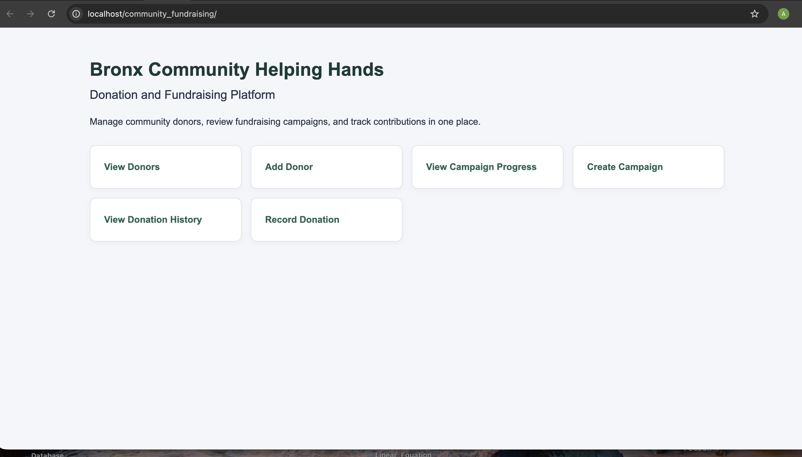
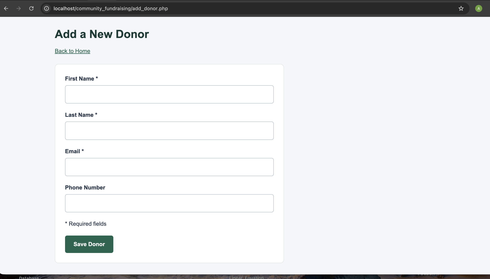
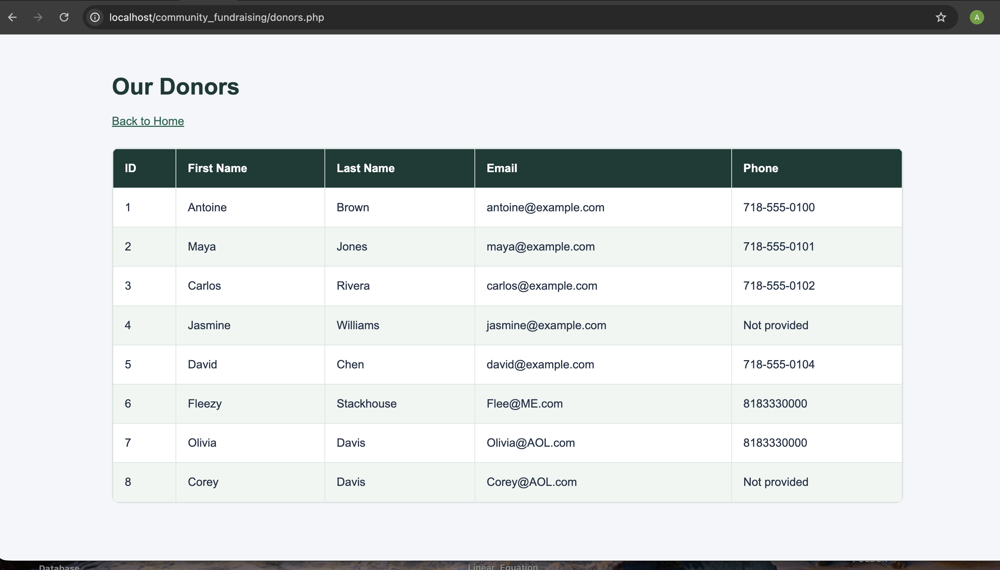
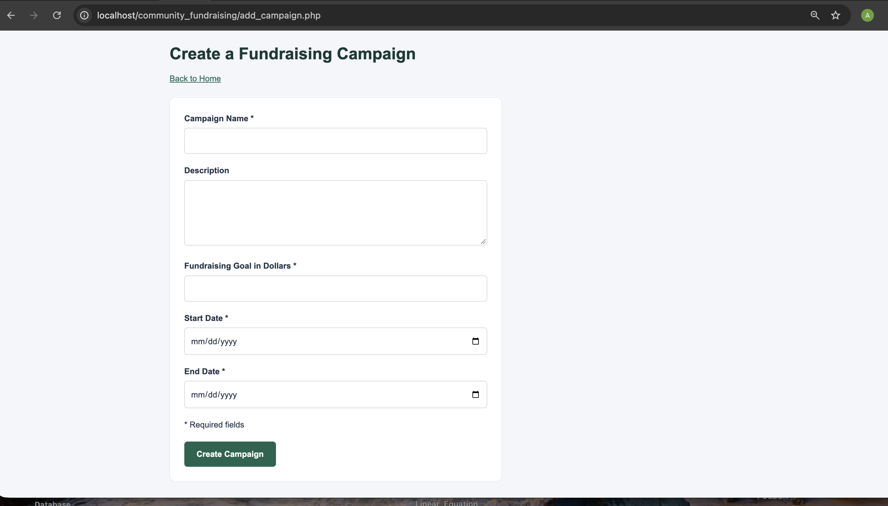
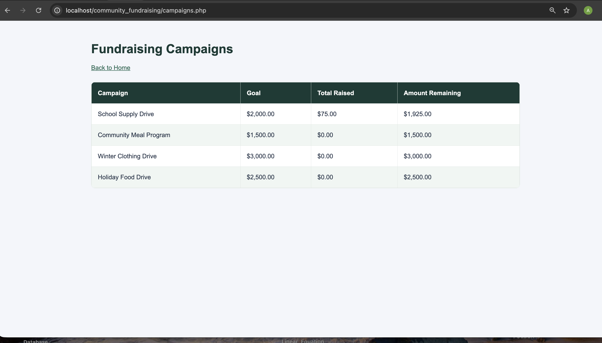
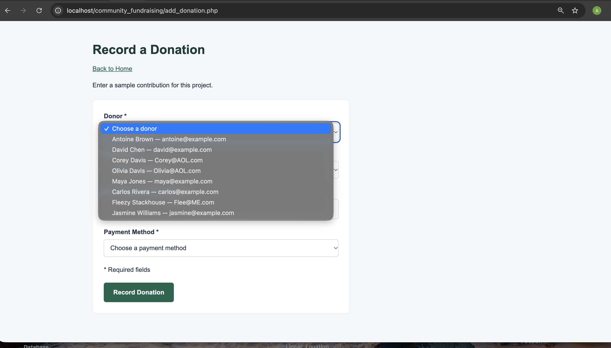
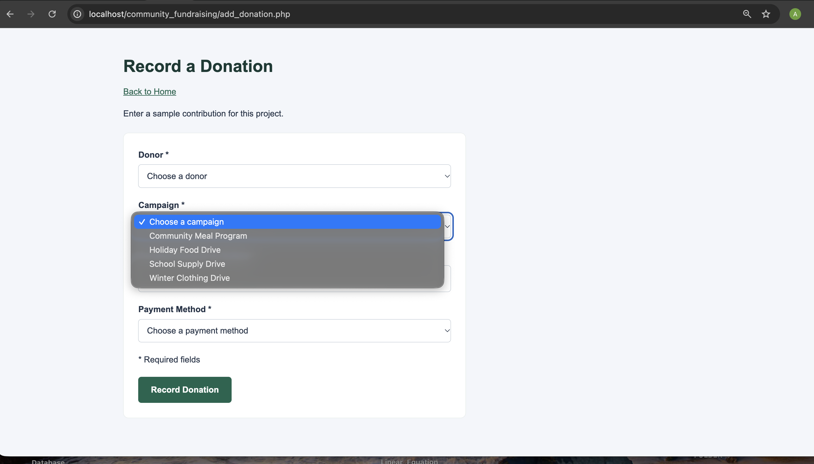
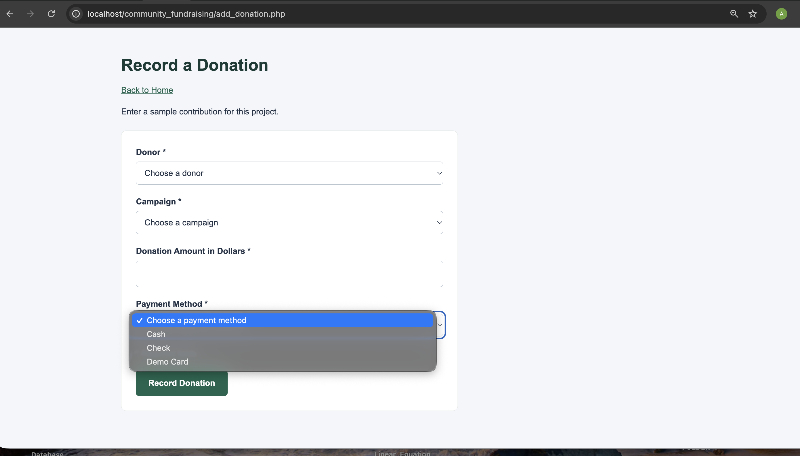
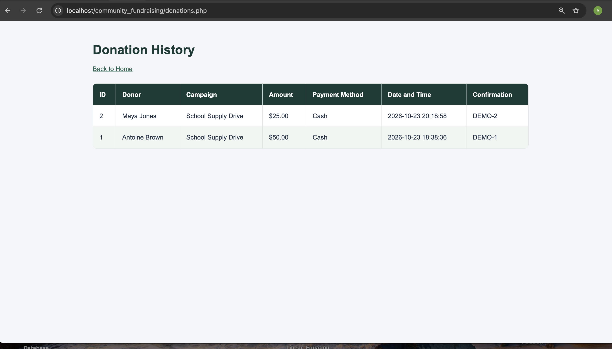

# Bronx Community Helping Hands — User Guide

This guide explains how to manage fictional donors, fundraising
campaigns, and sample donations.

## 1. Open the Home Page

With Apache and your MySQL server running, open:

http://localhost/community_fundraising/

The home page provides links to donor, campaign, and donation forms
and reports.

## 2. Add a Donor

1. From the home page, select Add Donor.
2. Enter the donor's first name, last name, and email address.
3. Enter a phone number if available.
4. Submit the form.
5. Confirm that the donor appears in the donors list.

Each donor must have a unique email address. An email address
already registered will be rejected.

## 3. Create a Campaign

1. Return to the home page and select Create Campaign.
2. Enter a campaign name.
3. Add an optional description.
4. Enter a fundraising goal greater than zero.
5. Choose the start and end dates.
6. Select Create Campaign.

The end date must be on or after the start date.

## 4. View Campaign Progress

1. Return to the home page.
2. Select View Campaign Progress.
3. Find your campaign in the table.
4. Review its fundraising goal, amount raised, and remaining amount.

A new campaign starts with zero raised. Recording a donation
increases the amount raised for its selected campaign.

## 5. Record a Donation

1. Return to the home page and open the donation form.
2. Select an existing donor from the donor dropdown.
3. Select the campaign receiving the donation.
4. Enter an amount greater than zero.
5. Select a payment method.
6. Submit the form once.
7. Confirm that the donation appears in Donation History.

The application saves the donation and its confirmation record
together in a database transaction.

## 6. View Donation History

1. From the home page, select View Donation History.
2. Find the donation you recorded.
3. Review the donor, campaign, amount, payment method,
   and confirmation code.
4. Open View Campaign Progress to confirm that the
   campaign's amount raised has increased.

## Demonstration Use

Use fictional donor information and sample donations.
This application does not process real payments.
Do not enter card numbers or bank account details.